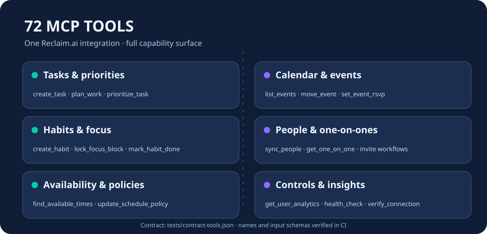

<p align="center"></p>
<h1 align="center">Cloud9-Reclaim-MCP</h1>
<p align="center"><strong>Serveur MCP Reclaim.ai complet : 72 outils et images Docker publiques prêtes à l'emploi.</strong></p>
<p align="center">🇬🇧 <a href="README.md">English</a> · Français · 🇨🇳 <a href="README.zh-CN.md">简体中文</a></p>

---

Cette distribution communautaire préserve les **72 outils** du code de [thechrisfischer/reclaim-mcp-server](https://github.com/thechrisfischer/reclaim-mcp-server), lui-même dérivé de [universalamateur/reclaim-mcp-server](https://github.com/universalamateur/reclaim-mcp-server). L'image Docker officielle du projet d'origine exposait seulement **49 outils** lors de la comparaison initiale. Aucune donnée utilisateur, clé API ou adresse de réseau privé n'est incluse.

## Pourquoi ?

- **Plus besoin de compiler sur ton serveur** : l'image GHCR est construite et testée par GitHub Actions.
- **72 outils vérifiés** : noms et schémas JSON d'entrée figés dans [tests/contract-tools.json](tests/contract-tools.json). La publication échoue en cas de perte.
- **Deux transports** : stdio local et HTTP MCP streamable via FastMCP.
- **Suivi hebdomadaire de l'amont** : notification des changements sans fusion aveugle ni régression.

<p align="center"></p>

## Installation

Pour un client MCP local utilisant stdio :

```bash
docker run --rm -i \
  -e RECLAIM_API_KEY="VOTRE_CLE_API" \
  -e RECLAIM_TOOL_PROFILE=full \
  ghcr.io/godsquantum/cloud9-reclaim-mcp:latest
```

Pour un endpoint HTTP local (port 8000, route `/mcp`) :

```bash
cp .env.example .env
# Renseigner RECLAIM_API_KEY uniquement dans .env.
docker compose -f compose.http.yaml up -d
```

L'endpoint HTTP permet des opérations sur les calendriers et les tâches : **ne jamais l'exposer sur Internet sans authentification de passerelle**. La configuration d'exemple écoute sur `127.0.0.1` uniquement.

## Fonctionnalités

Les outils couvrent tâches et priorités, événements et disponibilité, habitudes, blocs de concentration, réunions 1:1, personnes et politiques de programmation. Consulter [la liste exacte des outils](tests/contract-tools.json) et [la documentation API](docs/API.md). Le test CI vérifie la surface MCP ; les opérations réelles Reclaim nécessitent un compte et des droits adaptés.

## Maintenance

Chaque mise à jour de `main` passe par la vérification des 72 outils puis construit l'image pour GHCR. Une vérification hebdomadaire signale les nouveautés upstream via une issue GitHub, sans mettre automatiquement en production un code non testé. Voir [UPSTREAM.md](UPSTREAM.md).

Projet non affilié à Reclaim.ai. Licence MIT et auteurs originaux conservés dans [LICENSE](LICENSE).
