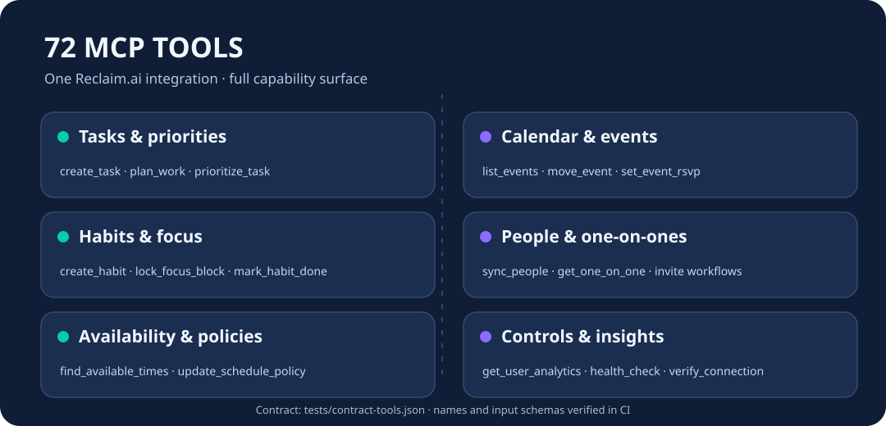

<p align="center"></p>
<h1 align="center">Cloud9-Reclaim-MCP</h1>
<p align="center"><strong>The full 72-tool Reclaim.ai MCP server, with public multi-platform Docker images.</strong><br>
Calendar · tasks · habits · focus · 1:1 meetings · people · scheduling policies</p>

<p align="center">
  <a href="LICENSE"></a>
  
  
  
  <a href="https://github.com/GodsQuantum/Cloud9-Reclaim-MCP/actions/workflows/publish.yml"></a>
</p>
<p align="center">English · 🇫🇷 <a href="README.fr.md">Français</a> · 🇨🇳 <a href="README.zh-CN.md">简体中文</a></p>

---

Cloud9-Reclaim-MCP packages the **72-tool** source from [thechrisfischer/reclaim-mcp-server](https://github.com/thechrisfischer/reclaim-mcp-server), a public MIT-licensed extension of [universalamateur/reclaim-mcp-server](https://github.com/universalamateur/reclaim-mcp-server). At the time of this project's creation, the vendor's Docker Hub `latest` image exposed **49 tools**, whereas this maintained source revision exposed **72** (all 72 names and input schemas are committed as a regression contract).

**Not affiliated with Reclaim.ai.** This project preserves its original authors' attribution and upstream license. There are no user credentials, server addresses, calendars or private Cloud9 settings in this repository or image.

## Why a community image?

- **No local rebuild on each update** — install a tested, pre-built image from GHCR; the source and CI live here.
- **72 tools, not just a tool-count claim** — `tests/contract-tools.json` records every tool's name and input schema; CI refuses publication on drift.
- **Both MCP transports** — standard stdio clients or HTTP `/mcp` through the package's existing FastMCP server.
- **Safe upgrade policy** — upstream changes are reviewed with a weekly GitHub Actions check; no blind merge that might drop tools.
- **Portable** — no hardcoded addresses, accounts or user-specific integrations.

<p align="center"></p>

## Quick start

### Stdio — local MCP clients

```bash
docker run --rm -i \
  -e RECLAIM_API_KEY="YOUR_RECLAIM_API_KEY" \
  -e RECLAIM_TOOL_PROFILE=full \
  ghcr.io/godsquantum/cloud9-reclaim-mcp:latest
```

For production, pass the API key from your MCP client/secret manager rather than committing it to a shell script.

### HTTP / streamable MCP

```bash
cp .env.example .env
# Set RECLAIM_API_KEY in .env, and keep the file private.
docker compose -f compose.http.yaml up -d
```

Connect an MCP client to `http://127.0.0.1:8000/mcp`. The example binds **localhost only**. Place an authenticated reverse proxy or MCP gateway in front of it before exposing it to another machine; the upstream server does not become a public auth gateway merely by serving HTTP.

## Tools

The complete machine-readable catalog is [tests/contract-tools.json](tests/contract-tools.json). The names include `create_task`, `list_tasks`, `plan_work`, `find_available_times`, `list_one_on_ones`, `sync_people` and `update_schedule_policy`. See also [upstream's API documentation](docs/API.md).

The contract certifies exported names and input schemas; it does **not** claim all Reclaim.ai account permissions or APIs were exercised without valid credentials.

## Updating and releasing

A push to `main` triggers the source build, exact 72-tool contract gate and GHCR publication. Tagged `v*` commits publish a matching version in addition to `latest`. A weekly workflow compares the base branch with its parent and opens an issue when upstream changes; reviewing/rebasing remains deliberate. Both systems run on GitHub runners, **not on the user's Docker host**. Clients only pull the new image after publication.

See [UPSTREAM.md](UPSTREAM.md) for source commits, maintenance steps and rollback. If a new upstream release preserves all 72 tool schemas and adds useful functionality, update the contract deliberately with an explicit review.

## Security and credits

- `RECLAIM_API_KEY` is a **runtime secret**. The public repository uses a placeholder only.
- Treat the HTTP endpoint as privileged: it can create/change/delete tasks and calendar items.
- MIT license and existing copyright/author credit remain in [LICENSE](LICENSE).
- Sources: [thechrisfischer/reclaim-mcp-server](https://github.com/thechrisfischer/reclaim-mcp-server), [universalamateur/reclaim-mcp-server](https://github.com/universalamateur/reclaim-mcp-server).
- Maintained packaging and compatibility tests by [GodsQuantum](https://github.com/GodsQuantum).
