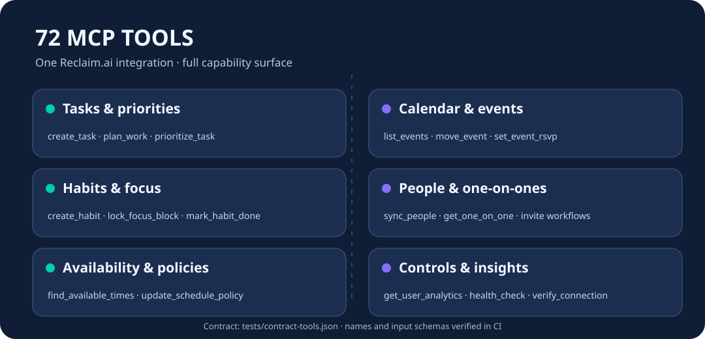

<p align="center"></p>
<h1 align="center">Cloud9-Reclaim-MCP</h1>
<p align="center"><strong>完整的 Reclaim.ai MCP 服务器：72 个工具，提供可直接拉取的公开 Docker 镜像。</strong></p>
<p align="center">🇬🇧 <a href="README.md">English</a> · 🇫🇷 <a href="README.fr.md">Français</a> · 简体中文</p>

---

本项目将 [thechrisfischer/reclaim-mcp-server](https://github.com/thechrisfischer/reclaim-mcp-server) 中提供的 **72 个工具** 打包为社区镜像。该项目基于 [universalamateur/reclaim-mcp-server](https://github.com/universalamateur/reclaim-mcp-server)，保留原始 MIT 许可证和作者署名。初次测试时，原项目的 Docker Hub `latest` 镜像仅提供 **49 个工具**。仓库不包含个人账户、API 密钥或私有服务器配置。

## 主要特性

- **无需在自己的服务器上编译**：GitHub Actions 构建并发布 GHCR 镜像。
- **完整的 72 个工具**：通过 [工具契约文件](tests/contract-tools.json) 比对每个工具名称和输入 JSON Schema，防止功能回退。
- **两种 MCP 传输模式**：stdio 和 Streamable HTTP。
- **安全的上游维护**：每周检查上游更新；功能测试通过后才允许发布新镜像。

<p align="center"></p>

## 快速开始

本地 stdio 模式：

```bash
docker run --rm -i \
  -e RECLAIM_API_KEY="YOUR_API_KEY" \
  -e RECLAIM_TOOL_PROFILE=full \
  ghcr.io/godsquantum/cloud9-reclaim-mcp:latest
```

本地 HTTP 模式（地址为 `http://127.0.0.1:8000/mcp`）：

```bash
cp .env.example .env
# 在 .env 中设置 RECLAIM_API_KEY，切勿提交密钥。
docker compose -f compose.http.yaml up -d
```

HTTP 工具可以修改任务和日历，因此**不要在没有身份验证的情况下暴露到公网**。示例默认只绑定本机回环地址。

## 工具与维护

主要功能包括任务、日历事件、专注时间、习惯、一对一会议、联系人和排程策略。查看 [72 个工具的完整清单](tests/contract-tools.json) 和 [API 文档](docs/API.md)。测试验证工具接口，但不会在没有授权的 Reclaim 账户上执行实际操作。

`main` 分支的每次发布都经过工具契约测试和 GitHub Actions 构建；定期检查上游变化，但不自动合并可能破坏功能的修改。详见 [UPSTREAM.md](UPSTREAM.md)。

本项目与 Reclaim.ai 官方无隶属关系。保留原始 MIT 许可证和作者归属。
